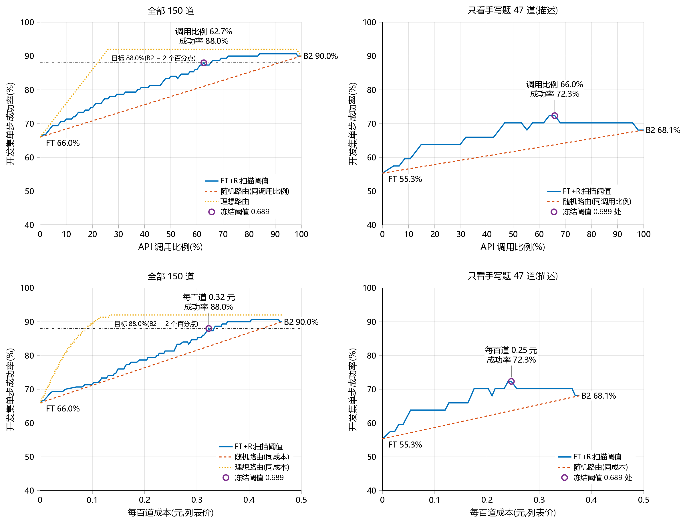

# 科研助理 Agent(research-assistant-agent)

面向每周 arXiv 前沿阅读的科研助理 Agent。一句话需求进来,Agent 检索 arXiv、筛选论文、读摘要与正文,按固定的读书笔记模板产出条目。负责选工具、填参数、输出合法 JSON 的是本地微调的小模型:M3–M6 是经 LoRA 微调的 Qwen3-1.7B,没把握时转交 DeepSeek;M7 换成思考模式的 Nanbeige4.1-3B 加 LoRA,完全在本地作答,每一步由 5 个样本投票,再经两条运行时规则修正。评测用自建并加锁的测试集,外加 BFCL 与 ACEBench 检查通用调用能力有没有退化。

A research-assistant agent for weekly arXiv reading. A small fine-tuned local model handles tool selection, argument filling and JSON output: in M3–M6 a LoRA-fine-tuned Qwen3-1.7B that routes to a large API model when unsure; in M7 a LoRA on Nanbeige4.1-3B in thinking mode that answers fully locally, each step by a vote of five samples followed by two runtime rules. Evaluation uses self-built, hash-locked test sets plus BFCL and ACEBench retention checks.

## 状态

- M0(环境与第一周验证)、M1、M2(评测集与数据)已完成,过程记录私有保存。原属所有者的模块(01–03、arXiv 解析、轨迹校验器、请求生成器、指标、笔记库)都已实现,按下文「分工」一节由所有者做设计决定与验收、Claude Code 写代码。
- M3(微调与第一次测试)已完成:FT 与 B4 两个 LoRA 适配器在本机训练,按预登记的规则在开发集上选出检查点,测试集按 [docs/m3-预登记.md](docs/m3-预登记.md) 第一次打开。过程记录私有保存。
- M4(置信度路由、故障注入、ACEBench):已完成。路由阈值已在开发集上冻结,路由曲线图、故障表与 ACEBench(B0、FT、B4)都已做完;过程记录私有保存。M4 不打开测试集。
- M5(第二次打开测试集,检验「FT+R 对 B2」):所有者 2026-10-17 同意后按 [docs/m5-预登记.md](docs/m5-预登记.md) 打开,结果见下文;过程记录私有保存。M5 已完成。
- M6(第二个适配器 FT2、按成本目标冻结的路由 R2、第三次打开测试集):计划 [docs/m6-计划.md](docs/m6-计划.md),预登记 [docs/m6-预登记.md](docs/m6-预登记.md)。开发侧的门槛 (iii)(冻结的路由在留出集 dev-ext 上的成功率)未达标,所有者 2026-10-18 决定撤销 H2、只检验 H1 与 H3,FT2+R2 只作描述;同日同意后打开,结果见下文;过程记录私有保存。M6 已完成。
- M7(换底座、思考训练、本地投票与运行时规则、新测试集 v2 的第 1 次打开):计划 [docs/m7-计划.md](docs/m7-计划.md) 与 [docs/m7-本地提升计划.md](docs/m7-本地提升计划.md),预登记 [docs/m7-预登记.md](docs/m7-预登记.md)(含修订 1、2)。所有者 2026-10-29 改以本地模型单独的成绩为目标(路由不再运行),2026-10-30 同意在干跑通过后打开 v2;结果见下文,过程记录私有保存。
- M8(修 ACEBench 的拒答退化:special-mix 续训出 FT5,自建开发集 A、B,预登记门槛):计划 [docs/m8-计划.md](docs/m8-计划.md),预登记 [docs/m8-预登记.md](docs/m8-预登记.md)(含修订 1)。按预登记为 NO-GO,ACEBench 没有运行;所有者 2026-11-05 决定收尾 M8,维持 M7 的最终系统。结果见下文,过程记录私有保存。M8 不打开测试集。
- v1 测试集的打开次数:单步测试集已打开 <!-- num:test_set.opens -->3<!-- /num --> 次(M3、M5、M6 各一次,计划上限 3 次已用完,次数以私有仓库中的访问日志为准,见 `docs/provenance.md`);端到端测试集每次都在同一会话中打开,它的访问日志记录的是同样的三次;每次打开都有完成标记。
- v1 的三次打开用完后(第 3 次为 M6,所有者 2026-10-18 同意),M7 新建了 v2 测试集(单步 300 道、端到端 150 个任务,沿用 v1 的划分、模板与主题,重新抽取槽位并新写手写题)。v2 单步测试集已打开 <!-- num:test_set_v2.opens -->1<!-- /num --> 次(M7,上限 3 次,次数以私有仓库中的访问日志为准),端到端在同一会话中打开,也有完成标记。
- 公开仓库:由私有仓库的提交 `5bbe77f` 导出,只含代码、测试、配置、计划与预登记、汇总结果、路由曲线图、语料与数据来源清单、许可说明、ACEBench 补丁(附其许可原文)和本说明;测试集、开发集、金标准、访问日志、逐题结果、录像、术语表数据与进度记录留在私有仓库。导出删去或改写了时区标注、时刻与一天中的时段、本机与个人细节、编程助手的工具细节、账户与计费和内部编号,预登记里的时刻改写为 UTC;锁的摘要、各次打开、对应的私有提交与改动的类别见 [docs/provenance.md](docs/provenance.md)。公开前的检查(密钥、本机路径、个人与时区信息、第三方文本与许可、评测集暴露)于 2026-11-05 在私有提交 `1134438` 上完成,修正后再导出;导出脚本另对每个公开文件复查密钥、本机路径、时区与个人信息、链接与本说明中的数字。
- 计划全文:[docs/plan.md](docs/plan.md);选题记录私有保存。

## 结果

本节每个数字都与 `results/numbers.json` 逐个对账;该文件由 `scripts/build_report.py` 从 `results/` 下的结果文件与测试集访问日志生成。公开仓库只含其中的汇总结果文件;逐题结果、测试结果与访问日志留在私有仓库,`results/numbers.json` 记着它们的 SHA-256,`scripts/check_public_numbers.py` 核对本节的数字与在场文件的哈希。

### 系统

| 系统 | 内容 |
|---|---|
| FT | Qwen3-1.7B + LoRA(r 16,α 32,七个投影),公开数据 4,000 条 + 合成数据 1,187 条,2 个 epoch;开发集选出第 <!-- num:checkpoint.ft.step -->1668<!-- /num --> 步 |
| B0 | Qwen3-1.7B 基座 |
| B1 | 基座加三条示例 |
| B4 | 与 FT 同一配方,只用公开数据;开发集选出第 <!-- num:checkpoint.b4.step -->417<!-- /num --> 步 |
| B2 | deepseek-flash,即生成合成训练数据的老师模型 |
| FT2(M6) | 与 FT 同配方,数据改为公开 4,000 条 + 格式混合 1,500 条 + 基座回放 500 条 + 机械变换后的合成数据 1,846 条(M6 进度记录 WP2、WP3,私有保存);开发集选出第 <!-- num:checkpoint.ft2.step -->1644<!-- /num --> 步 |
| FT3(M7) | Nanbeige4.1-3B + LoRA(QLoRA,r 16,α 32),思考模式训练;数据为 FT2 的全部数据(其中 1.7B 的基座回放换成本底座的自回放)加 flash 新生成的轨迹 889 条及其思考;在开发集 dev ∪ dev-v2(<!-- num:checkpoint.ft3.n -->276<!-- /num --> 道)选出第 <!-- num:checkpoint.ft3.step -->1635<!-- /num --> 步 |
| final(M7) | FT3 第 1635 步,思考预算 1,280 个 token;每一步由 5 个采样回答投票(平局取贪心回答所在的一类),再经两条运行时规则:瞬时错误后原样重发失败的调用,按历史修复 arXiv 编号 |
| finalg(M7) | FT3 第 1635 步单次贪心,不投票、不用规则 |

本地系统都用 llama.cpp(Q8_0 基座、f16 适配器、单槽、贪心解码、关闭前缀缓存)。B0、B1 在 FT 服务器上以 LoRA 缩放 0 运行;在开发集上核对过,结果与不加载适配器的服务器逐字节相同。M7 的 final 另以采样生成 5 个样本(温度 0.6、top-p 0.95,第 k 个样本的种子为 k)。

### 测试集 v2:M7 的预登记比较(第 1 次打开)

单步测试集 `data/eval/v2/test-v2.jsonl`,共 <!-- num:compare.test-m7.final-vs-ft2.n -->300<!-- /num --> 道(草拟 <!-- num:eval.test-m7-final-normalized-drafted.n -->192<!-- /num --> 道、手写 <!-- num:eval.test-m7-final-normalized-handwritten.n -->108<!-- /num --> 道)。主分是归一评分(所有者 2026-10-29 定:date_to 等于当天视同省略,检索词里的连字符视同空格,请求没给数量时 top_k、limit、max_chars 取缺省值或金标准值都算对),原评分并列报告。检验族是两个假设,Holm 一起校正;区间口径同 v1(聚类共 <!-- num:compare.test-m7.final-vs-ft2.clusters -->142<!-- /num --> 簇)。

| 假设 | 被比较系统 | 对照 | 差 | 配对 95% 区间 | 聚类 95% 区间 | 只被比较系统对 / 只对照对 | $p$ | Holm $p$ |
|---|---|---|---|---|---|---|---|---|
| H1:final 对 FT2(单步,归一评分) | <!-- num:compare.test-m7.final-vs-ft2.success_a -->87.7%<!-- /num --> | <!-- num:compare.test-m7.final-vs-ft2.success_b -->75.7%<!-- /num --> | <!-- num:compare.test-m7.final-vs-ft2.diff -->+12.0<!-- /num --> | <!-- num:compare.test-m7.final-vs-ft2.ci -->[+7.3, +16.7]<!-- /num --> | <!-- num:compare.test-m7.final-vs-ft2.cluster_ci -->[+6.8, +18.2]<!-- /num --> | <!-- num:compare.test-m7.final-vs-ft2.a_only -->46<!-- /num --> / <!-- num:compare.test-m7.final-vs-ft2.b_only -->10<!-- /num --> | <!-- num:compare.test-m7.final-vs-ft2.p --><0.001<!-- /num --> | <!-- num:compare.test-m7.final-vs-ft2.p_holm --><0.001<!-- /num --> |
| H3:FT3 第 1635 步对 B0,ACEBench(<!-- num:compare.test-m7.final-vs-b0-acebench.strata -->30<!-- /num --> 层均值,非劣余量 <!-- num:compare.test-m7.final-vs-b0-acebench.margin -->2.0<!-- /num --> 个百分点) | <!-- num:compare.test-m7.final-vs-b0-acebench.mean_a -->73.69%<!-- /num --> | <!-- num:compare.test-m7.final-vs-b0-acebench.mean_b -->77.66%<!-- /num --> | <!-- num:compare.test-m7.final-vs-b0-acebench.diff -->-3.96<!-- /num --> | <!-- num:compare.test-m7.final-vs-b0-acebench.ci -->[-5.83, -2.09]<!-- /num --> | — | — | <!-- num:compare.test-m7.final-vs-b0-acebench.p_ni -->0.980<!-- /num -->(单侧 $p_{\mathrm{NI}}$) | <!-- num:compare.test-m7.final-vs-b0-acebench.p_holm -->0.980<!-- /num --> |

描述(不进检验族,无 $p$):

| 比较 | 被比较系统 | 对照 | 差 | 配对 95% 区间 | 聚类 95% 区间 | 只被比较系统对 / 只对照对 |
|---|---|---|---|---|---|---|
| final 对 finalg(归一评分) | <!-- num:compare.test-m7.final-vs-finalg.success_a -->87.7%<!-- /num --> | <!-- num:compare.test-m7.final-vs-finalg.success_b -->82.3%<!-- /num --> | <!-- num:compare.test-m7.final-vs-finalg.diff -->+5.3<!-- /num --> | <!-- num:compare.test-m7.final-vs-finalg.ci -->[+2.0, +9.0]<!-- /num --> | <!-- num:compare.test-m7.final-vs-finalg.cluster_ci -->[+2.4, +8.9]<!-- /num --> | <!-- num:compare.test-m7.final-vs-finalg.a_only -->23<!-- /num --> / <!-- num:compare.test-m7.final-vs-finalg.b_only -->7<!-- /num --> |
| final 对 B2(归一评分) | <!-- num:compare.test-m7.final-vs-b2.success_a -->87.7%<!-- /num --> | <!-- num:compare.test-m7.final-vs-b2.success_b -->83.3%<!-- /num --> | <!-- num:compare.test-m7.final-vs-b2.diff -->+4.3<!-- /num --> | <!-- num:compare.test-m7.final-vs-b2.ci -->[-0.7, +9.3]<!-- /num --> | <!-- num:compare.test-m7.final-vs-b2.cluster_ci -->[-1.4, +11.1]<!-- /num --> | <!-- num:compare.test-m7.final-vs-b2.a_only -->37<!-- /num --> / <!-- num:compare.test-m7.final-vs-b2.b_only -->24<!-- /num --> |
| final 对 FT2(原评分) | <!-- num:compare.test-m7.final-vs-ft2-default.success_a -->84.0%<!-- /num --> | <!-- num:compare.test-m7.final-vs-ft2-default.success_b -->72.0%<!-- /num --> | <!-- num:compare.test-m7.final-vs-ft2-default.diff -->+12.0<!-- /num --> | <!-- num:compare.test-m7.final-vs-ft2-default.ci -->[+7.3, +16.7]<!-- /num --> | <!-- num:compare.test-m7.final-vs-ft2-default.cluster_ci -->[+6.7, +18.1]<!-- /num --> | <!-- num:compare.test-m7.final-vs-ft2-default.a_only -->46<!-- /num --> / <!-- num:compare.test-m7.final-vs-ft2-default.b_only -->10<!-- /num --> |

各系统的成功率(描述):

| 系统 | 单步(归一评分) | 草拟题 | 手写题 | 单步(原评分) | 端到端 |
|---|---|---|---|---|---|
| final | <!-- num:eval.test-m7-final-normalized.success -->87.7%<!-- /num --> | <!-- num:eval.test-m7-final-normalized-drafted.success -->91.1%<!-- /num --> | <!-- num:eval.test-m7-final-normalized-handwritten.success -->81.5%<!-- /num --> | <!-- num:eval.test-m7-final.success -->84.0%<!-- /num --> | <!-- num:e2e.test-m7-final.success -->81.3%<!-- /num -->(<!-- num:e2e.test-m7-final.n -->150<!-- /num --> 个任务) |
| finalg | <!-- num:eval.test-m7-finalg-normalized.success -->82.3%<!-- /num --> | <!-- num:eval.test-m7-finalg-normalized-drafted.success -->88.5%<!-- /num --> | <!-- num:eval.test-m7-finalg-normalized-handwritten.success -->71.3%<!-- /num --> | <!-- num:eval.test-m7-finalg.success -->78.3%<!-- /num --> | —(只跑单步) |
| FT2 | <!-- num:eval.test-m7-ft2-normalized.success -->75.7%<!-- /num --> | <!-- num:eval.test-m7-ft2-normalized-drafted.success -->83.3%<!-- /num --> | <!-- num:eval.test-m7-ft2-normalized-handwritten.success -->62.0%<!-- /num --> | <!-- num:eval.test-m7-ft2.success -->72.0%<!-- /num --> | <!-- num:e2e.test-m7-ft2.success -->62.0%<!-- /num -->(<!-- num:e2e.test-m7-ft2.n -->150<!-- /num --> 个任务) |
| B2 | <!-- num:eval.test-m7-b2-normalized.success -->83.3%<!-- /num --> | <!-- num:eval.test-m7-b2-normalized-drafted.success -->100.0%<!-- /num --> | <!-- num:eval.test-m7-b2-normalized-handwritten.success -->53.7%<!-- /num --> | <!-- num:eval.test-m7-b2.success -->83.3%<!-- /num --> | <!-- num:e2e.test-m7-b2.success -->40.9%<!-- /num -->(<!-- num:e2e.test-m7-b2.n -->93<!-- /num --> 个任务,见下) |

- H1 成立:final 高于 FT2 <!-- num:compare.test-m7.final-vs-ft2.diff -->+12.0<!-- /num --> 个百分点,两种区间都不含 0;原评分下差距相同。
- H3 不成立:ACEBench 上 FT3 第 1635 步与未训练的底座之差为 <!-- num:compare.test-m7.final-vs-b0-acebench.diff -->-3.96<!-- /num --> 个百分点,区间整个低于 −2 个百分点的余量。差距主要在 special 组,即要求用固定句式拒答缺参数或无关请求的题。
- 所有者给本地模型定的目标是单步 90%:final 为 <!-- num:eval.test-m7-final-normalized.success -->87.7%<!-- /num -->,没有达到,与打开前的事先预测(预登记修订 2)相符。
- 投票与运行时规则相对单次贪心(finalg)提高 <!-- num:compare.test-m7.final-vs-finalg.diff -->+5.3<!-- /num --> 个百分点,区间不含 0;提高主要在手写题上。
- B2 在草拟题上的分数来自缓存回放(金标准就是它当时的回答),不说明能力;手写题上 final <!-- num:eval.test-m7-final-normalized-handwritten.success -->81.5%<!-- /num -->,B2 <!-- num:eval.test-m7-b2-normalized-handwritten.success -->53.7%<!-- /num -->。
- B2 的端到端在第 <!-- num:e2e.test-m7-b2.n -->93<!-- /num --> 个任务时用满了预设的 5 元上限而停下,只作描述。

### M8:修 ACEBench 的拒答退化(预登记,未通过门槛)

M7 的 H3 不成立:ACEBench 上 FT3 第 1635 步与未训练的底座之差为 <!-- num:compare.test-m7.final-vs-b0-acebench.diff -->-3.96<!-- /num --> 个百分点,差距主要在要求用规定句式拒答的 special 组。M8 从 FT3 第 1635 步接着训练出 FT5:训练数据加入由公开记录构造的 special-mix(以参数值有误、缺参数、请求无关三种拒答情形为主,另有合法调用:原值照抄、多轮、近似非法而合法),FT3 的原样本按步类型分层回放 25%。两份自建开发集、门槛、数据修订的条件与「ACEBench 只跑一次」都在 FT5 出任何分数之前写入预登记([docs/m8-预登记.md](docs/m8-预登记.md)):开发集 A 只判断是否修订数据(第一版 FT5 触发了修订条件,数据按预登记修订一次后重训),开发集 B 只用来选点。<!-- num:decision.m8.candidates -->4<!-- /num --> 个检查点先按 dev ∪ dev-v2(<!-- num:checkpoint.ft5-normalized.n -->276<!-- /num --> 道)上种子 0、1 的成功数之和 $S$ 排序(离线作用运行时规则,归一评分),再沿排序在开发集 B 上检查门槛 PG1–PG4;第一个全部通过的检查点若 $S$ 不低于 FT3 减 10,才在 ACEBench 上跑唯一一次。

开发集 B(思考、贪心、$R = 1{,}280$)上门槛用的是特殊组 <!-- num:decision.m8.b0.special_n -->150<!-- /num --> 道与合法题 <!-- num:decision.m8.b0.valid_n -->90<!-- /num --> 道。特殊组的「严格」要求答案恰为本题规定的句子且槽位填对,「宽松」是 ACEBench 式的子串规则;误拒是合法题中没有发出调用的题数,中文值改写是改写了须原样保留的中文参数值的题数。FT5 各行按 $S$ 从高到低排列($S$ 相同时较晚的一步在前),也是开发集 B 的运行顺序:

| 系统 | $S$ | 特殊组严格 | 特殊组宽松 | 合法题调用正确 | 误拒 | 中文值改写 | PG1 / PG2 / PG3 / PG4 |
|---|---|---|---|---|---|---|---|
| B0(Nanbeige4.1-3B 未训练) | — | <!-- num:decision.m8.b0.strict -->26<!-- /num -->(<!-- num:decision.m8.b0.strict_rate -->17.3%<!-- /num -->) | <!-- num:decision.m8.b0.lenient -->103<!-- /num -->(<!-- num:decision.m8.b0.lenient_rate -->68.7%<!-- /num -->) | <!-- num:decision.m8.b0.exact -->58<!-- /num -->(<!-- num:decision.m8.b0.exact_rate -->64.4%<!-- /num -->) | <!-- num:decision.m8.b0.false_refusals -->11<!-- /num --> | <!-- num:decision.m8.b0.zh_altered -->0<!-- /num --> | — |
| FT3 第 1635 步 | <!-- num:decision.m8.ft3.sum -->475<!-- /num --> | <!-- num:decision.m8.ft3.strict -->49<!-- /num -->(<!-- num:decision.m8.ft3.strict_rate -->32.7%<!-- /num -->) | <!-- num:decision.m8.ft3.lenient -->103<!-- /num -->(<!-- num:decision.m8.ft3.lenient_rate -->68.7%<!-- /num -->) | <!-- num:decision.m8.ft3.exact -->64<!-- /num -->(<!-- num:decision.m8.ft3.exact_rate -->71.1%<!-- /num -->) | <!-- num:decision.m8.ft3.false_refusals -->11<!-- /num --> | <!-- num:decision.m8.ft3.zh_altered -->0<!-- /num --> | — |
| FT5 第 348 步 | <!-- num:decision.m8.ft5-348.sum -->471<!-- /num --> | <!-- num:decision.m8.ft5-348.strict -->82<!-- /num -->(<!-- num:decision.m8.ft5-348.strict_rate -->54.7%<!-- /num -->) | <!-- num:decision.m8.ft5-348.lenient -->99<!-- /num -->(<!-- num:decision.m8.ft5-348.lenient_rate -->66.0%<!-- /num -->) | <!-- num:decision.m8.ft5-348.exact -->71<!-- /num -->(<!-- num:decision.m8.ft5-348.exact_rate -->78.9%<!-- /num -->) | <!-- num:decision.m8.ft5-348.false_refusals -->8<!-- /num --> | <!-- num:decision.m8.ft5-348.zh_altered -->0<!-- /num --> | <!-- num:decision.m8.ft5-348.pg1 -->no<!-- /num --> / <!-- num:decision.m8.ft5-348.pg2 -->no<!-- /num --> / <!-- num:decision.m8.ft5-348.pg3 -->yes<!-- /num --> / <!-- num:decision.m8.ft5-348.pg4 -->yes<!-- /num --> |
| FT5 第 232 步 | <!-- num:decision.m8.ft5-232.sum -->468<!-- /num --> | <!-- num:decision.m8.ft5-232.strict -->76<!-- /num -->(<!-- num:decision.m8.ft5-232.strict_rate -->50.7%<!-- /num -->) | <!-- num:decision.m8.ft5-232.lenient -->94<!-- /num -->(<!-- num:decision.m8.ft5-232.lenient_rate -->62.7%<!-- /num -->) | <!-- num:decision.m8.ft5-232.exact -->71<!-- /num -->(<!-- num:decision.m8.ft5-232.exact_rate -->78.9%<!-- /num -->) | <!-- num:decision.m8.ft5-232.false_refusals -->10<!-- /num --> | <!-- num:decision.m8.ft5-232.zh_altered -->0<!-- /num --> | <!-- num:decision.m8.ft5-232.pg1 -->no<!-- /num --> / <!-- num:decision.m8.ft5-232.pg2 -->no<!-- /num --> / <!-- num:decision.m8.ft5-232.pg3 -->yes<!-- /num --> / <!-- num:decision.m8.ft5-232.pg4 -->yes<!-- /num --> |
| FT5 第 116 步 | <!-- num:decision.m8.ft5-116.sum -->468<!-- /num --> | <!-- num:decision.m8.ft5-116.strict -->63<!-- /num -->(<!-- num:decision.m8.ft5-116.strict_rate -->42.0%<!-- /num -->) | <!-- num:decision.m8.ft5-116.lenient -->85<!-- /num -->(<!-- num:decision.m8.ft5-116.lenient_rate -->56.7%<!-- /num -->) | <!-- num:decision.m8.ft5-116.exact -->67<!-- /num -->(<!-- num:decision.m8.ft5-116.exact_rate -->74.4%<!-- /num -->) | <!-- num:decision.m8.ft5-116.false_refusals -->12<!-- /num --> | <!-- num:decision.m8.ft5-116.zh_altered -->1<!-- /num --> | <!-- num:decision.m8.ft5-116.pg1 -->no<!-- /num --> / <!-- num:decision.m8.ft5-116.pg2 -->no<!-- /num --> / <!-- num:decision.m8.ft5-116.pg3 -->yes<!-- /num --> / <!-- num:decision.m8.ft5-116.pg4 -->no<!-- /num --> |
| FT5 第 462 步 | <!-- num:decision.m8.ft5-462.sum -->461<!-- /num --> | <!-- num:decision.m8.ft5-462.strict -->79<!-- /num -->(<!-- num:decision.m8.ft5-462.strict_rate -->52.7%<!-- /num -->) | <!-- num:decision.m8.ft5-462.lenient -->96<!-- /num -->(<!-- num:decision.m8.ft5-462.lenient_rate -->64.0%<!-- /num -->) | <!-- num:decision.m8.ft5-462.exact -->73<!-- /num -->(<!-- num:decision.m8.ft5-462.exact_rate -->81.1%<!-- /num -->) | <!-- num:decision.m8.ft5-462.false_refusals -->6<!-- /num --> | <!-- num:decision.m8.ft5-462.zh_altered -->1<!-- /num --> | <!-- num:decision.m8.ft5-462.pg1 -->no<!-- /num --> / <!-- num:decision.m8.ft5-462.pg2 -->no<!-- /num --> / <!-- num:decision.m8.ft5-462.pg3 -->yes<!-- /num --> / <!-- num:decision.m8.ft5-462.pg4 -->no<!-- /num --> |

- 门槛(预登记):PG1 原为宽松特殊组不低于 B0 加 0.05;预登记规定 K1(开发集 B 上 B0 的宽松特殊组比 FT3 高至少 0.05)不成立时 PG1 改用严格特殊组 ≥ 0.75,校准时两者相同,ACEBench 上的宽松差距在这里没有复现,故用回退门槛。PG2 为严格 ≥ 0.70;PG3 为误拒不多于 FT3 加 2;PG4 为调用正确率不低于 FT3 减 5 个百分点,且中文值改写不多于 FT3。
- 结果为 <!-- num:decision.m8.decision -->NO-GO<!-- /num -->:没有检查点通过 PG1–PG4,ACEBench 没有运行。
- 开发集 B 上,续训改善了规定句式:严格特殊组由 FT3 的 <!-- num:decision.m8.ft3.strict_rate -->32.7%<!-- /num --> 升到 <!-- num:decision.m8.ft5-116.strict_rate -->42.0%<!-- /num -->–<!-- num:decision.m8.ft5-348.strict_rate -->54.7%<!-- /num -->,合法题的调用正确都高于 FT3,误拒与 FT3 相近(PG3 全部通过);但严格特殊组离 0.70 与 0.75 仍远。剩下的失败中最多的一类是答成另一情形的句式,宽松特殊组(<!-- num:decision.m8.ft5-116.lenient -->85<!-- /num -->–<!-- num:decision.m8.ft5-348.lenient -->99<!-- /num -->)也低于 B0(<!-- num:decision.m8.b0.lenient -->103<!-- /num -->)与 FT3(<!-- num:decision.m8.ft3.lenient -->103<!-- /num -->)。第 116、462 步各有中文值改写,PG4 也不通过。
- 主任务:$S$ 由 FT3 的 <!-- num:decision.m8.ft3.sum -->475<!-- /num --> 降到 <!-- num:decision.m8.ft5-462.sum -->461<!-- /num -->–<!-- num:decision.m8.ft5-348.sum -->471<!-- /num -->。
- ACEBench 在 M8 中一次也没有运行(只有不启动模型的干跑),预登记的唯一一次没有用掉;训练与选点不用 ACEBench 的题目、句子、调用写法与函数名(special-mix 按 M7 中 FT3 与 B0 在 ACEBench 上的失败类型设计,预登记已披露)。最终系统仍是 M7 的 final,上文 M7 的结果不变;所有者 2026-11-05 决定收尾 M8。来源 `results/decision-m8.json` 与 `results/checkpoint-selection-ft5.json`;过程记录私有保存。

### 测试集:预登记的主要比较

单步决策测试集 `data/eval/test.jsonl`,共 <!-- num:compare.test-m3.ft-vs-b0.n -->300<!-- /num --> 道。效应量是成功率之差(百分点)。区间为配对 bootstrap 95%,另报聚类 bootstrap(草拟题按模板族、手写题各自成簇,共 <!-- num:compare.test-m3.ft-vs-b0.clusters -->163<!-- /num --> 簇),区间都不做多重校正。检验为精确 McNemar(只用结果不一致的题),4 个主比较一起做 Holm 校正。第 4 个比较「FT+R 对 B2」在 M3 时按 $p = 1$ 计入,M5 第二次打开测试集时检验:前 3 个比较带着 M3 的 $p$ 值,与它一起重新做 Holm 校正(M5 最终)。

| 比较 | 被比较系统 | 对照 | 差 | 配对 95% 区间 | 聚类 95% 区间 | 只被比较系统对 / 只对照对 | $p$ | Holm $p$(M3) | Holm $p$(M5,最终) |
|---|---|---|---|---|---|---|---|---|---|
| FT 对 B0 | <!-- num:compare.test-m3.ft-vs-b0.success_a -->63.3%<!-- /num --> | <!-- num:compare.test-m3.ft-vs-b0.success_b -->30.3%<!-- /num --> | <!-- num:compare.test-m3.ft-vs-b0.diff -->+33.0<!-- /num --> | <!-- num:compare.test-m3.ft-vs-b0.ci -->[+26.3, +39.3]<!-- /num --> | <!-- num:compare.test-m3.ft-vs-b0.cluster_ci -->[+22.3, +42.9]<!-- /num --> | <!-- num:compare.test-m3.ft-vs-b0.a_only -->116<!-- /num --> / <!-- num:compare.test-m3.ft-vs-b0.b_only -->17<!-- /num --> | <!-- num:compare.test-m3.ft-vs-b0.p --><0.001<!-- /num --> | <!-- num:compare.test-m3.ft-vs-b0.p_holm --><0.001<!-- /num --> | <!-- num:compare.test-m5.ft-vs-b0.p_holm --><0.001<!-- /num --> |
| FT 对 B1 | <!-- num:compare.test-m3.ft-vs-b1.success_a -->63.3%<!-- /num --> | <!-- num:compare.test-m3.ft-vs-b1.success_b -->52.0%<!-- /num --> | <!-- num:compare.test-m3.ft-vs-b1.diff -->+11.3<!-- /num --> | <!-- num:compare.test-m3.ft-vs-b1.ci -->[+4.0, +18.3]<!-- /num --> | <!-- num:compare.test-m3.ft-vs-b1.cluster_ci -->[+0.9, +21.5]<!-- /num --> | <!-- num:compare.test-m3.ft-vs-b1.a_only -->77<!-- /num --> / <!-- num:compare.test-m3.ft-vs-b1.b_only -->43<!-- /num --> | <!-- num:compare.test-m3.ft-vs-b1.p -->0.002<!-- /num --> | <!-- num:compare.test-m3.ft-vs-b1.p_holm -->0.005<!-- /num --> | <!-- num:compare.test-m5.ft-vs-b1.p_holm -->0.002<!-- /num --> |
| FT 对 B4 | <!-- num:compare.test-m3.ft-vs-b4.success_a -->63.3%<!-- /num --> | <!-- num:compare.test-m3.ft-vs-b4.success_b -->32.0%<!-- /num --> | <!-- num:compare.test-m3.ft-vs-b4.diff -->+31.3<!-- /num --> | <!-- num:compare.test-m3.ft-vs-b4.ci -->[+24.3, +38.3]<!-- /num --> | <!-- num:compare.test-m3.ft-vs-b4.cluster_ci -->[+19.6, +41.8]<!-- /num --> | <!-- num:compare.test-m3.ft-vs-b4.a_only -->117<!-- /num --> / <!-- num:compare.test-m3.ft-vs-b4.b_only -->23<!-- /num --> | <!-- num:compare.test-m3.ft-vs-b4.p --><0.001<!-- /num --> | <!-- num:compare.test-m3.ft-vs-b4.p_holm --><0.001<!-- /num --> | <!-- num:compare.test-m5.ft-vs-b4.p_holm --><0.001<!-- /num --> |
| FT+R 对 B2(M5) | <!-- num:compare.test-m5.ftr-vs-b2.success_a -->78.7%<!-- /num --> | <!-- num:compare.test-m5.ftr-vs-b2.success_b -->85.3%<!-- /num --> | <!-- num:compare.test-m5.ftr-vs-b2.diff -->-6.7<!-- /num --> | <!-- num:compare.test-m5.ftr-vs-b2.ci -->[-10.3, -3.3]<!-- /num --> | <!-- num:compare.test-m5.ftr-vs-b2.cluster_ci -->[-15.7, +0.4]<!-- /num --> | <!-- num:compare.test-m5.ftr-vs-b2.a_only -->5<!-- /num --> / <!-- num:compare.test-m5.ftr-vs-b2.b_only -->25<!-- /num --> | <!-- num:compare.test-m5.ftr-vs-b2.p --><0.001<!-- /num --> | <!-- num:compare.test-m3.ftr-vs-b2.p_holm -->1.000<!-- /num -->(按 $p = 1$ 计入) | <!-- num:compare.test-m5.ftr-vs-b2.p_holm --><0.001<!-- /num --> |

- M3 检验的三个比较中,FT 都高于对照,Holm 校正后 $p < 0.05$。相对 B1(基座加三条示例)的提高最小,聚类区间的下限接近 0。M5 换上第 4 个比较的实际 $p$ 值后,这三个比较校正后的 $p$ 值只会变小或不变,结论不变。
- 第 4 个比较:FT+R 低于 B2,差 <!-- num:compare.test-m5.ftr-vs-b2.diff -->-6.7<!-- /num --> 个百分点,Holm 校正后 $p < 0.05$;聚类区间 <!-- num:compare.test-m5.ftr-vs-b2.cluster_ci -->[-15.7, +0.4]<!-- /num --> 含 0,稳健性检查下差距不确定。
- 非劣界(描述,所有者 2026-10-17 定):配对区间的下界 <!-- num:compare.test-m5.ftr-vs-b2.noninferiority.paired_low -->-10.3<!-- /num -->、聚类区间的下界 <!-- num:compare.test-m5.ftr-vs-b2.noninferiority.cluster_low -->-15.7<!-- /num -->,都低于 −<!-- num:compare.test-m5.ftr-vs-b2.noninferiority.margin -->2.0<!-- /num --> 个百分点,不满足非劣。
- 这个比较偏向 B2:草拟题的金标准就是 B2 当时的回答(M3 已披露),预登记仍以全部 300 道为终点。只看手写题(描述):FT+R <!-- num:eval.test-m5-ftr-handwritten.success -->66.9%<!-- /num -->,B2 <!-- num:eval.test-m3-b2-handwritten.success -->66.2%<!-- /num -->,FT <!-- num:eval.test-m3-ft-handwritten.success -->64.6%<!-- /num -->。

### 测试集:M6 的预登记比较(第 3 次打开)

M6 的检验族只有两个假设,Holm 一起校正;原计划的 H2「FT2+R2 对 B2 非劣」在开发侧门槛未达标后、打开之前撤销,改为描述([docs/m6-预登记.md](docs/m6-预登记.md) 记录了这次修订)。参考系统不重跑:FT、B2 用 M3 的逐题记录,FT+R 用 M5 的,在 M6 会话里用同一份评分代码重新打分,逐题分数与原来相同(B2 <!-- num:compare.test-m6.rescored.b2.equal -->yes<!-- /num -->、FT <!-- num:compare.test-m6.rescored.ft.equal -->yes<!-- /num -->、FT+R <!-- num:compare.test-m6.rescored.ftr.equal -->yes<!-- /num -->)。

| 假设 | 被比较系统 | 对照 | 差 | 配对 95% 区间 | 聚类 95% 区间 | 只被比较系统对 / 只对照对 | $p$ | Holm $p$ |
|---|---|---|---|---|---|---|---|---|
| H1:FT2 对 FT(单步,<!-- num:compare.test-m6.ft2-vs-ft.n -->300<!-- /num --> 道) | <!-- num:compare.test-m6.ft2-vs-ft.success_a -->74.3%<!-- /num --> | <!-- num:compare.test-m6.ft2-vs-ft.success_b -->63.3%<!-- /num --> | <!-- num:compare.test-m6.ft2-vs-ft.diff -->+11.0<!-- /num --> | <!-- num:compare.test-m6.ft2-vs-ft.ci -->[+5.7, +16.3]<!-- /num --> | <!-- num:compare.test-m6.ft2-vs-ft.cluster_ci -->[+2.4, +21.2]<!-- /num --> | <!-- num:compare.test-m6.ft2-vs-ft.a_only -->51<!-- /num --> / <!-- num:compare.test-m6.ft2-vs-ft.b_only -->18<!-- /num --> | <!-- num:compare.test-m6.ft2-vs-ft.p --><0.001<!-- /num --> | <!-- num:compare.test-m6.ft2-vs-ft.p_holm --><0.001<!-- /num --> |
| H3:FT2 对 B0,ACEBench(<!-- num:compare.test-m6.ft2-vs-b0-acebench.strata -->30<!-- /num --> 层均值,非劣余量 <!-- num:compare.test-m6.ft2-vs-b0-acebench.margin -->2.0<!-- /num --> 个百分点) | <!-- num:compare.test-m6.ft2-vs-b0-acebench.mean_a -->47.17%<!-- /num --> | <!-- num:compare.test-m6.ft2-vs-b0-acebench.mean_b -->45.36%<!-- /num --> | <!-- num:compare.test-m6.ft2-vs-b0-acebench.diff -->+1.81<!-- /num --> | <!-- num:compare.test-m6.ft2-vs-b0-acebench.ci -->[-0.39, +4.03]<!-- /num --> | — | — | <!-- num:compare.test-m6.ft2-vs-b0-acebench.p_ni --><0.001<!-- /num -->(单侧 $p_{\mathrm{NI}}$) | <!-- num:compare.test-m6.ft2-vs-b0-acebench.p_holm --><0.001<!-- /num --> |

描述(不进检验族,无 $p$):

| 比较 | 被比较系统 | 对照 | 差 | 配对 95% 区间 | 聚类 95% 区间 | 只被比较系统对 / 只对照对 |
|---|---|---|---|---|---|---|
| FT2+R2 对 B2 | <!-- num:compare.test-m6.ft2r-vs-b2.success_a -->81.3%<!-- /num --> | <!-- num:compare.test-m6.ft2r-vs-b2.success_b -->85.3%<!-- /num --> | <!-- num:compare.test-m6.ft2r-vs-b2.diff -->-4.0<!-- /num --> | <!-- num:compare.test-m6.ft2r-vs-b2.ci -->[-9.0, +0.7]<!-- /num --> | <!-- num:compare.test-m6.ft2r-vs-b2.cluster_ci -->[-9.9, +1.7]<!-- /num --> | <!-- num:compare.test-m6.ft2r-vs-b2.a_only -->21<!-- /num --> / <!-- num:compare.test-m6.ft2r-vs-b2.b_only -->33<!-- /num --> |
| FT2+R2 对 FT+R(M5) | <!-- num:compare.test-m6.ft2r-vs-ftr.success_a -->81.3%<!-- /num --> | <!-- num:compare.test-m6.ft2r-vs-ftr.success_b -->78.7%<!-- /num --> | <!-- num:compare.test-m6.ft2r-vs-ftr.diff -->+2.7<!-- /num --> | <!-- num:compare.test-m6.ft2r-vs-ftr.ci -->[-2.3, +8.0]<!-- /num --> | <!-- num:compare.test-m6.ft2r-vs-ftr.cluster_ci -->[-5.5, +12.7]<!-- /num --> | <!-- num:compare.test-m6.ft2r-vs-ftr.a_only -->34<!-- /num --> / <!-- num:compare.test-m6.ft2r-vs-ftr.b_only -->26<!-- /num --> |

- H1 成立:FT2 高于 FT 11.0 个百分点,两种区间都不含 0。
- H3 成立:FT2 在 ACEBench 上不低于 B0(非劣余量 2 个百分点,分层配对 bootstrap);点估计高于 B0 1.8 个百分点,但区间含 0,只能说「不退化」。
- FT2+R2 对 B2 的差 −4.0 个百分点,配对区间下界 −9.0 低于 −2 个百分点的非劣界(描述);对 FT+R 高 2.7 个百分点,区间含 0。

### 测试集:各系统的成功率(描述,不做检验)

| 系统 | 单步全部 | 草拟题(<!-- num:eval.test-m3-ft-drafted.n -->170<!-- /num --> 道) | 手写题(<!-- num:eval.test-m3-ft-handwritten.n -->130<!-- /num --> 道) | 端到端(<!-- num:e2e.test-m3-ft.n -->60<!-- /num --> 个任务) |
|---|---|---|---|---|
| FT | <!-- num:eval.test-m3-ft.success -->63.3%<!-- /num --> | <!-- num:eval.test-m3-ft-drafted.success -->62.4%<!-- /num --> | <!-- num:eval.test-m3-ft-handwritten.success -->64.6%<!-- /num --> | <!-- num:e2e.test-m3-ft.success -->70.0%<!-- /num --> |
| B0 | <!-- num:eval.test-m3-b0.success -->30.3%<!-- /num --> | <!-- num:eval.test-m3-b0-drafted.success -->34.7%<!-- /num --> | <!-- num:eval.test-m3-b0-handwritten.success -->24.6%<!-- /num --> | <!-- num:e2e.test-m3-b0.success -->21.7%<!-- /num --> |
| B1 | <!-- num:eval.test-m3-b1.success -->52.0%<!-- /num --> | <!-- num:eval.test-m3-b1-drafted.success -->54.7%<!-- /num --> | <!-- num:eval.test-m3-b1-handwritten.success -->48.5%<!-- /num --> | <!-- num:e2e.test-m3-b1.success -->36.7%<!-- /num --> |
| B4 | <!-- num:eval.test-m3-b4.success -->32.0%<!-- /num --> | <!-- num:eval.test-m3-b4-drafted.success -->26.5%<!-- /num --> | <!-- num:eval.test-m3-b4-handwritten.success -->39.2%<!-- /num --> | <!-- num:e2e.test-m3-b4.success -->28.3%<!-- /num --> |
| B2 | <!-- num:eval.test-m3-b2.success -->85.3%<!-- /num --> | <!-- num:eval.test-m3-b2-drafted.success -->100.0%<!-- /num --> | <!-- num:eval.test-m3-b2-handwritten.success -->66.2%<!-- /num --> | <!-- num:e2e.test-m3-b2.success -->73.3%<!-- /num --> |
| FT+R(M5) | <!-- num:eval.test-m5-ftr.success -->78.7%<!-- /num --> | <!-- num:eval.test-m5-ftr-drafted.success -->87.6%<!-- /num --> | <!-- num:eval.test-m5-ftr-handwritten.success -->66.9%<!-- /num --> | <!-- num:e2e.test-m5-ftr.success -->76.7%<!-- /num --> |
| FT2(M6) | <!-- num:eval.test-m6-ft2.success -->74.3%<!-- /num --> | <!-- num:eval.test-m6-ft2-drafted.success -->81.8%<!-- /num --> | <!-- num:eval.test-m6-ft2-handwritten.success -->64.6%<!-- /num --> | <!-- num:e2e.test-m6-ft2.success -->71.7%<!-- /num --> |
| FT2+R2(M6) | <!-- num:eval.test-m6-ft2r.success -->81.3%<!-- /num --> | <!-- num:eval.test-m6-ft2r-drafted.success -->88.8%<!-- /num --> | <!-- num:eval.test-m6-ft2r-handwritten.success -->71.5%<!-- /num --> | <!-- num:e2e.test-m6-ft2r.success -->88.3%<!-- /num --> |

B2 在草拟题上的金标准就是它当时的回答,且由响应缓存返回,所以草拟题上的分数不说明能力;在手写题上,FT 与 B2 接近。端到端任务较少,只作描述。

### 测试集:误差分类(描述,不做检验)

单步测试集上各系统失败的题,按计划的 11 类误差分类法计数(`eval/metrics.py`,每道失败的题只归一类,结构类先判);FT+R 来自 M5,其余来自 M3。

| 误差类别 | FT | FT+R | B0 | B1 | B4 | B2 |
|---|---|---|---|---|---|---|
| 选错工具 | <!-- num:eval.test-m3-ft.errors.wrong_tool -->21<!-- /num --> | <!-- num:eval.test-m5-ftr.errors.wrong_tool -->22<!-- /num --> | <!-- num:eval.test-m3-b0.errors.wrong_tool -->54<!-- /num --> | <!-- num:eval.test-m3-b1.errors.wrong_tool -->25<!-- /num --> | <!-- num:eval.test-m3-b4.errors.wrong_tool -->69<!-- /num --> | <!-- num:eval.test-m3-b2.errors.wrong_tool -->20<!-- /num --> |
| 缺参 | <!-- num:eval.test-m3-ft.errors.missing_param -->0<!-- /num --> | <!-- num:eval.test-m5-ftr.errors.missing_param -->0<!-- /num --> | <!-- num:eval.test-m3-b0.errors.missing_param -->0<!-- /num --> | <!-- num:eval.test-m3-b1.errors.missing_param -->1<!-- /num --> | <!-- num:eval.test-m3-b4.errors.missing_param -->0<!-- /num --> | <!-- num:eval.test-m3-b2.errors.missing_param -->0<!-- /num --> |
| 多参 | <!-- num:eval.test-m3-ft.errors.extra_param -->4<!-- /num --> | <!-- num:eval.test-m5-ftr.errors.extra_param -->5<!-- /num --> | <!-- num:eval.test-m3-b0.errors.extra_param -->35<!-- /num --> | <!-- num:eval.test-m3-b1.errors.extra_param -->16<!-- /num --> | <!-- num:eval.test-m3-b4.errors.extra_param -->21<!-- /num --> | <!-- num:eval.test-m3-b2.errors.extra_param -->7<!-- /num --> |
| 值或格式错 | <!-- num:eval.test-m3-ft.errors.wrong_value -->45<!-- /num --> | <!-- num:eval.test-m5-ftr.errors.wrong_value -->31<!-- /num --> | <!-- num:eval.test-m3-b0.errors.wrong_value -->17<!-- /num --> | <!-- num:eval.test-m3-b1.errors.wrong_value -->17<!-- /num --> | <!-- num:eval.test-m3-b4.errors.wrong_value -->16<!-- /num --> | <!-- num:eval.test-m3-b2.errors.wrong_value -->10<!-- /num --> |
| 编号编造 | <!-- num:eval.test-m3-ft.errors.fabricated_id -->5<!-- /num --> | <!-- num:eval.test-m5-ftr.errors.fabricated_id -->0<!-- /num --> | <!-- num:eval.test-m3-b0.errors.fabricated_id -->3<!-- /num --> | <!-- num:eval.test-m3-b1.errors.fabricated_id -->1<!-- /num --> | <!-- num:eval.test-m3-b4.errors.fabricated_id -->0<!-- /num --> | <!-- num:eval.test-m3-b2.errors.fabricated_id -->0<!-- /num --> |
| 不该调却调 | <!-- num:eval.test-m3-ft.errors.unwanted_call -->10<!-- /num --> | <!-- num:eval.test-m5-ftr.errors.unwanted_call -->3<!-- /num --> | <!-- num:eval.test-m3-b0.errors.unwanted_call -->40<!-- /num --> | <!-- num:eval.test-m3-b1.errors.unwanted_call -->20<!-- /num --> | <!-- num:eval.test-m3-b4.errors.unwanted_call -->51<!-- /num --> | <!-- num:eval.test-m3-b2.errors.unwanted_call -->4<!-- /num --> |
| 该追问没追问 | <!-- num:eval.test-m3-ft.errors.no_clarify -->23<!-- /num --> | <!-- num:eval.test-m5-ftr.errors.no_clarify -->3<!-- /num --> | <!-- num:eval.test-m3-b0.errors.no_clarify -->35<!-- /num --> | <!-- num:eval.test-m3-b1.errors.no_clarify -->29<!-- /num --> | <!-- num:eval.test-m3-b4.errors.no_clarify -->40<!-- /num --> | <!-- num:eval.test-m3-b2.errors.no_clarify -->3<!-- /num --> |
| 恢复不当 | <!-- num:eval.test-m3-ft.errors.bad_recovery -->0<!-- /num --> | <!-- num:eval.test-m5-ftr.errors.bad_recovery -->0<!-- /num --> | <!-- num:eval.test-m3-b0.errors.bad_recovery -->25<!-- /num --> | <!-- num:eval.test-m3-b1.errors.bad_recovery -->34<!-- /num --> | <!-- num:eval.test-m3-b4.errors.bad_recovery -->5<!-- /num --> | <!-- num:eval.test-m3-b2.errors.bad_recovery -->0<!-- /num --> |
| 重试风暴 | <!-- num:eval.test-m3-ft.errors.retry_storm -->0<!-- /num --> | <!-- num:eval.test-m5-ftr.errors.retry_storm -->0<!-- /num --> | <!-- num:eval.test-m3-b0.errors.retry_storm -->0<!-- /num --> | <!-- num:eval.test-m3-b1.errors.retry_storm -->0<!-- /num --> | <!-- num:eval.test-m3-b4.errors.retry_storm -->1<!-- /num --> | <!-- num:eval.test-m3-b2.errors.retry_storm -->0<!-- /num --> |
| JSON 损坏 | <!-- num:eval.test-m3-ft.errors.broken_json -->2<!-- /num --> | <!-- num:eval.test-m5-ftr.errors.broken_json -->0<!-- /num --> | <!-- num:eval.test-m3-b0.errors.broken_json -->0<!-- /num --> | <!-- num:eval.test-m3-b1.errors.broken_json -->1<!-- /num --> | <!-- num:eval.test-m3-b4.errors.broken_json -->1<!-- /num --> | <!-- num:eval.test-m3-b2.errors.broken_json -->0<!-- /num --> |
| 思考块泄漏 | <!-- num:eval.test-m3-ft.errors.think_leak -->0<!-- /num --> | <!-- num:eval.test-m5-ftr.errors.think_leak -->0<!-- /num --> | <!-- num:eval.test-m3-b0.errors.think_leak -->0<!-- /num --> | <!-- num:eval.test-m3-b1.errors.think_leak -->0<!-- /num --> | <!-- num:eval.test-m3-b4.errors.think_leak -->0<!-- /num --> | <!-- num:eval.test-m3-b2.errors.think_leak -->0<!-- /num --> |

- FT 最多的是「值或格式错」(<!-- num:eval.test-m3-ft.errors.wrong_value -->45<!-- /num --> 道)、「该追问没追问」(<!-- num:eval.test-m3-ft.errors.no_clarify -->23<!-- /num --> 道)和「选错工具」(<!-- num:eval.test-m3-ft.errors.wrong_tool -->21<!-- /num --> 道)。
- FT+R 把「该追问没追问」从 <!-- num:eval.test-m3-ft.errors.no_clarify -->23<!-- /num --> 道降到 <!-- num:eval.test-m5-ftr.errors.no_clarify -->3<!-- /num --> 道、「值或格式错」从 <!-- num:eval.test-m3-ft.errors.wrong_value -->45<!-- /num --> 道降到 <!-- num:eval.test-m5-ftr.errors.wrong_value -->31<!-- /num --> 道;「选错工具」没有减少(<!-- num:eval.test-m3-ft.errors.wrong_tool -->21<!-- /num --> 道对 <!-- num:eval.test-m5-ftr.errors.wrong_tool -->22<!-- /num --> 道),B2 自己也有 <!-- num:eval.test-m3-b2.errors.wrong_tool -->20<!-- /num --> 道。
- B0 与只用公开数据微调的 B4,「选错工具」「不该调却调」「该追问没追问」都远多于 FT:B0 依次为 <!-- num:eval.test-m3-b0.errors.wrong_tool -->54<!-- /num -->、<!-- num:eval.test-m3-b0.errors.unwanted_call -->40<!-- /num -->、<!-- num:eval.test-m3-b0.errors.no_clarify -->35<!-- /num --> 道,B4 为 <!-- num:eval.test-m3-b4.errors.wrong_tool -->69<!-- /num -->、<!-- num:eval.test-m3-b4.errors.unwanted_call -->51<!-- /num -->、<!-- num:eval.test-m3-b4.errors.no_clarify -->40<!-- /num --> 道;B1 最多的是「恢复不当」(<!-- num:eval.test-m3-b1.errors.bad_recovery -->34<!-- /num --> 道)。

### M5:FT+R 在测试集上的路由(描述)

FT+R 用 M4 冻结的阈值,在第二次打开的测试集上只运行这一次。B2 不重跑:用 M3 第一次打开时的逐题记录,在 M5 会话里用同一份评分代码重新打分(与 M3 的分数相比,逐题不同的有 B2 <!-- num:compare.test-m5.rescored.b2.differ -->0<!-- /num --> 道、FT <!-- num:compare.test-m5.rescored.ft.differ -->0<!-- /num --> 道)。

- 转交:<!-- num:eval.test-m5-ftr.routing.routed -->196<!-- /num -->/<!-- num:eval.test-m5-ftr.routing.n -->300<!-- /num --> 道(<!-- num:eval.test-m5-ftr.routing.api_share -->65.3%<!-- /num -->),其中硬触发 <!-- num:eval.test-m5-ftr.routing.hard -->8<!-- /num --> 道(参数没通过执行器校验 <!-- num:eval.test-m5-ftr.routing.hard.invalid_args -->6<!-- /num --> 道,解析失败 <!-- num:eval.test-m5-ftr.routing.hard.parse_failure -->2<!-- /num --> 道)。
- 同转交比例的随机路由:期望成功率 <!-- num:eval.test-m5-ftr.routing.random_success -->77.7%<!-- /num -->(由 M3 中 FT 的 <!-- num:eval.test-m5-ftr.routing.reference_success.ft -->63.3%<!-- /num --> 与 B2 的 <!-- num:eval.test-m5-ftr.routing.reference_success.b2 -->85.3%<!-- /num --> 精确算出);FT+R 为 <!-- num:eval.test-m5-ftr.success -->78.7%<!-- /num -->。开发集上,同比例随机路由是 <!-- num:routing.m4.random_success -->81.0%<!-- /num -->,FT+R 是 <!-- num:routing.m4.success -->88.0%<!-- /num -->:路由信号在测试集上带来的收益比开发集小得多。
- 一致性:本地作答的 <!-- num:eval.test-m5-ftr.routing.agreement.local.n -->104<!-- /num --> 道,回答与 M3 中 FT 的回答逐字节相同的有 <!-- num:eval.test-m5-ftr.routing.agreement.local.equal -->104<!-- /num --> 道;转交的 <!-- num:eval.test-m5-ftr.routing.agreement.routed.n -->196<!-- /num --> 道,与 M3 中 B2 的回答相同的有 <!-- num:eval.test-m5-ftr.routing.agreement.routed.equal -->196<!-- /num --> 道。
- 端到端(描述):FT+R 成功率 <!-- num:e2e.test-m5-ftr.success -->76.7%<!-- /num -->(M3 时 B2 <!-- num:e2e.test-m3-b2.success -->73.3%<!-- /num -->,FT <!-- num:e2e.test-m3-ft.success -->70.0%<!-- /num -->);<!-- num:e2e.test-m5-ftr.routing.tasks -->60<!-- /num --> 个任务里有 <!-- num:e2e.test-m5-ftr.routing.tasks_routed -->58<!-- /num --> 个在途中转交,本地 <!-- num:e2e.test-m5-ftr.routing.local_steps -->30<!-- /num --> 步、云端 <!-- num:e2e.test-m5-ftr.routing.cloud_steps -->194<!-- /num --> 步。
- 成本:单步转交的 <!-- num:resources.test-m5.ftr.cost.single_step.turns -->196<!-- /num --> 个回合全部命中缓存,按列表价折算 <!-- num:resources.test-m5.ftr.cost.single_step.list_rmb -->1.015<!-- /num --> 元;端到端实付 <!-- num:resources.test-m5.ftr.cost.e2e.paid_rmb -->0.358<!-- /num --> 元(<!-- num:resources.test-m5.ftr.cost.e2e.paid_calls -->68<!-- /num --> 次付费调用,<!-- num:resources.test-m5.ftr.cost.e2e.cache_hits -->126<!-- /num --> 次命中缓存),每个任务 <!-- num:resources.test-m5.ftr.cost.per_task_fen -->0.60<!-- /num --> 分。
- 时延:本地作答的每次调用 p50 / p95 为 <!-- num:resources.test-m5.ftr.single_step.local.p50_ms -->759<!-- /num --> / <!-- num:resources.test-m5.ftr.single_step.local.p95_ms -->3928<!-- /num --> ms;转交的每次调用(含本地那次尝试)为 <!-- num:resources.test-m5.ftr.single_step.routed.p50_ms -->1038<!-- /num --> / <!-- num:resources.test-m5.ftr.single_step.routed.p95_ms -->4824<!-- /num --> ms。服务器运行期间显存峰值比空闲基线高 <!-- num:resources.test-m5.server.ft.vram_mib -->2934<!-- /num --> MiB。
- 来源 `results/test-m5-*.json`(私有仓库);过程记录私有保存。

### M6:FT2+R2 在测试集上的路由(描述)

FT2+R2 用 M6 在开发集上按「每百道成本最低」目标冻结的规则:文本回答一律本地(策略 <!-- num:routing.m6.policy -->P1<!-- /num -->),带调用的回合在决策 token 最小概率低于 <!-- num:routing.m6.threshold -->0.430<!-- /num --> 时转交 B2;开发集上转交 <!-- num:routing.m6.routed -->23<!-- /num -->/150 道、成功 <!-- num:routing.m6.success -->88.0%<!-- /num -->、<!-- num:routing.m6.cost_per_100_rmb -->0.114<!-- /num --> 元/百道。预登记的留出集门槛(dev-ext 上成功率不低于 B2 减 4 个百分点)未达标:dev-ext 上转交 <!-- num:routing.m6.validation.dev-ext.routed -->15<!-- /num -->/132 道,成功 <!-- num:routing.m6.validation.dev-ext.success -->81.8%<!-- /num -->(FT2 <!-- num:routing.m6.validation.dev-ext.ft_success -->75.8%<!-- /num -->,B2 <!-- num:routing.m6.validation.dev-ext.b2_success -->94.7%<!-- /num -->),成本 <!-- num:routing.m6.validation.dev-ext.cost_per_100_rmb -->0.091<!-- /num --> 元/百道;H2 因此在打开前撤销,下面的数字只作描述。端到端改为逐步路由(每步独立判定,最终文本回答不转交),与 M5 的「一旦转交就留在云端」不可直接比较。

- 转交:<!-- num:eval.test-m6-ft2r.routing.routed -->37<!-- /num -->/<!-- num:eval.test-m6-ft2r.routing.n -->300<!-- /num --> 道(<!-- num:eval.test-m6-ft2r.routing.api_share -->12.3%<!-- /num -->;M5 的 FT+R 转交 <!-- num:eval.test-m5-ftr.routing.routed -->196<!-- /num --> 道),其中硬触发 <!-- num:eval.test-m6-ft2r.routing.hard -->5<!-- /num -->;成功率 <!-- num:eval.test-m6-ft2r.success -->81.3%<!-- /num -->(FT2 <!-- num:eval.test-m6-ft2r.routing.reference_success.ft2 -->74.3%<!-- /num -->,B2 <!-- num:eval.test-m6-ft2r.routing.reference_success.b2 -->85.3%<!-- /num -->),同转交比例的随机路由期望 <!-- num:eval.test-m6-ft2r.routing.random_success -->75.7%<!-- /num -->。
- 一致性:本地作答的 <!-- num:eval.test-m6-ft2r.routing.agreement.local.n -->263<!-- /num --> 道,回答与 FT2 的单步记录逐字节相同的有 <!-- num:eval.test-m6-ft2r.routing.agreement.local.equal -->263<!-- /num --> 道;转交的 <!-- num:eval.test-m6-ft2r.routing.agreement.routed.n -->37<!-- /num --> 道,回答与 M3 中 B2 的记录逐字节相同的有 <!-- num:eval.test-m6-ft2r.routing.agreement.routed.equal -->37<!-- /num --> 道。
- 端到端(描述):FT2+R2 成功率 <!-- num:e2e.test-m6-ft2r.success -->88.3%<!-- /num -->(FT2 <!-- num:e2e.test-m6-ft2.success -->71.7%<!-- /num -->,M3 时 B2 <!-- num:e2e.test-m3-b2.success -->73.3%<!-- /num -->,M5 的 FT+R <!-- num:e2e.test-m5-ftr.success -->76.7%<!-- /num -->);<!-- num:e2e.test-m6-ft2r.routing.tasks -->60<!-- /num --> 个任务里 <!-- num:e2e.test-m6-ft2r.routing.tasks_routed -->29<!-- /num --> 个有转交,本地 <!-- num:e2e.test-m6-ft2r.routing.local_steps -->194<!-- /num --> 步、云端 <!-- num:e2e.test-m6-ft2r.routing.cloud_steps -->38<!-- /num --> 步(模式 <!-- num:e2e.test-m6-ft2r.routing.mode -->stepwise<!-- /num -->)。
- 成本:单步转交的 <!-- num:resources.test-m6.ft2r.cost.single_step.turns -->37<!-- /num --> 个回合全部命中缓存,按列表价折算 <!-- num:resources.test-m6.ft2r.cost.single_step.list_rmb -->0.235<!-- /num --> 元(M5 的 FT+R 为 <!-- num:resources.test-m5.ftr.cost.single_step.list_rmb -->1.015<!-- /num --> 元);端到端实付 <!-- num:resources.test-m6.ft2r.cost.paid_rmb -->0.134<!-- /num --> 元(付费调用 <!-- num:resources.test-m6.ft2r.cost.e2e.paid_calls -->26<!-- /num --> 次、缓存命中 <!-- num:resources.test-m6.ft2r.cost.e2e.cache_hits -->12<!-- /num --> 次;M5 的 FT+R 为 <!-- num:resources.test-m5.ftr.cost.e2e.paid_rmb -->0.358<!-- /num --> 元),每任务 <!-- num:resources.test-m6.ft2r.cost.per_task_fen -->0.22<!-- /num --> 分。
- 时延:本地作答的每次调用 p50 / p95 为 <!-- num:resources.test-m6.ft2r.single_step.local.p50_ms -->728<!-- /num --> / <!-- num:resources.test-m6.ft2r.single_step.local.p95_ms -->4694<!-- /num --> ms;转交的每次调用(含本地那次尝试)为 <!-- num:resources.test-m6.ft2r.single_step.routed.p50_ms -->1063<!-- /num --> / <!-- num:resources.test-m6.ft2r.single_step.routed.p95_ms -->4373<!-- /num --> ms。
- 按题型,FT2 对 FT:call <!-- num:eval.test-m6-ft2.success.call -->78.3%<!-- /num --> 对 <!-- num:eval.test-m3-ft.success.call -->58.3%<!-- /num -->、clarify <!-- num:eval.test-m6-ft2.success.clarify -->62.5%<!-- /num --> 对 <!-- num:eval.test-m3-ft.success.clarify -->27.5%<!-- /num -->、recover <!-- num:eval.test-m6-ft2.success.recover -->97.5%<!-- /num --> 对 <!-- num:eval.test-m3-ft.success.recover -->92.5%<!-- /num -->;no_call <!-- num:eval.test-m6-ft2.success.no_call -->64.0%<!-- /num --> 对 <!-- num:eval.test-m3-ft.success.no_call -->78.0%<!-- /num -->,变差(不该调却调 <!-- num:eval.test-m6-ft2.errors.unwanted_call -->19<!-- /num --> 道对 <!-- num:eval.test-m3-ft.errors.unwanted_call -->10<!-- /num --> 道),开发集上没有这一迹象。FT2 的提高几乎全在草拟题上:手写题 <!-- num:eval.test-m6-ft2-handwritten.success -->64.6%<!-- /num -->,与 FT 的 <!-- num:eval.test-m3-ft-handwritten.success -->64.6%<!-- /num --> 相同。
- 来源 `results/test-m6-*.json`(私有仓库)与 `results/routing-m6.json`;过程记录私有保存。

### 时延、显存与成本(测试会话)

| 系统 | 单步每次调用 p50 / p95(ms) | 端到端每步 p50 / p95(ms) |
|---|---|---|
| FT | <!-- num:resources.test-m3.ft.single_step.p50_ms -->745<!-- /num --> / <!-- num:resources.test-m3.ft.single_step.p95_ms -->4088<!-- /num --> | <!-- num:resources.test-m3.ft.e2e_step.p50_ms -->1699<!-- /num --> / <!-- num:resources.test-m3.ft.e2e_step.p95_ms -->7032<!-- /num --> |
| B0 | <!-- num:resources.test-m3.b0.single_step.p50_ms -->900<!-- /num --> / <!-- num:resources.test-m3.b0.single_step.p95_ms -->2715<!-- /num --> | <!-- num:resources.test-m3.b0.e2e_step.p50_ms -->1380<!-- /num --> / <!-- num:resources.test-m3.b0.e2e_step.p95_ms -->6418<!-- /num --> |
| B1 | <!-- num:resources.test-m3.b1.single_step.p50_ms -->1040<!-- /num --> / <!-- num:resources.test-m3.b1.single_step.p95_ms -->3687<!-- /num --> | <!-- num:resources.test-m3.b1.e2e_step.p50_ms -->1974<!-- /num --> / <!-- num:resources.test-m3.b1.e2e_step.p95_ms -->8120<!-- /num --> |
| B4 | <!-- num:resources.test-m3.b4.single_step.p50_ms -->1090<!-- /num --> / <!-- num:resources.test-m3.b4.single_step.p95_ms -->4464<!-- /num --> | <!-- num:resources.test-m3.b4.e2e_step.p50_ms -->1247<!-- /num --> / <!-- num:resources.test-m3.b4.e2e_step.p95_ms -->6032<!-- /num --> |
| B2 | <!-- num:resources.test-m3.b2.single_step.p50_ms -->1287<!-- /num --> / <!-- num:resources.test-m3.b2.single_step.p95_ms -->4608<!-- /num -->(付费调用 <!-- num:resources.test-m3.b2.single_step.n -->130<!-- /num --> 次) | <!-- num:resources.test-m3.b2.e2e_step.p50_ms -->1713<!-- /num --> / <!-- num:resources.test-m3.b2.e2e_step.p95_ms -->4048<!-- /num -->(全部付费的 <!-- num:resources.test-m3.b2.e2e_step.n -->216<!-- /num --> 步) |

- 本地时延是上界:每次都从头计算提示;笔记本 GPU 在温度上限附近运行。
- 显存:服务器运行期间显存峰值比空闲基线高 <!-- num:resources.test-m3.server.ft.vram_mib -->2948<!-- /num --> MiB(FT 服务器)与 <!-- num:resources.test-m3.server.b4.vram_mib -->2942<!-- /num --> MiB(B4 服务器);平均功耗 <!-- num:resources.test-m3.server.ft.power_mean_w -->64.6<!-- /num --> W 与 <!-- num:resources.test-m3.server.b4.power_mean_w -->59.9<!-- /num --> W。
- 成本:B2 实付 <!-- num:resources.test-m3.b2.cost.paid_rmb -->1.988<!-- /num --> 元,按列表价折算全部回合为 <!-- num:resources.test-m3.b2.cost.list_rmb -->2.843<!-- /num --> 元,端到端每个任务 <!-- num:resources.test-m3.b2.cost.per_task_fen -->2.36<!-- /num --> 分;本地系统没有 API 成本。

### BFCL 单轮回归

bfcl-eval 的 <!-- num:bfcl.m3.ft.categories -->11<!-- /num --> 个单轮类别,共 <!-- num:bfcl.m3.ft.n -->3491<!-- /num --> 题,汇总分为各类别准确率的算术平均:B0 <!-- num:bfcl.m3.b0.aggregate -->75.90%<!-- /num -->,FT <!-- num:bfcl.m3.ft.aggregate -->78.03%<!-- /num -->。BFCL 上通用调用能力没有整体退化(ACEBench 的结果不同,见下一节)。回退最大的是 live_irrelevance(B0 <!-- num:bfcl.m3.b0.live_irrelevance -->82.24%<!-- /num -->,FT <!-- num:bfcl.m3.ft.live_irrelevance -->71.38%<!-- /num -->):FT 在与所给函数无关的真实请求上更常调用工具。各类别见 M3 的进度记录(私有保存)。

### M4:ACEBench 回归

ACEBench(上游提交 `56dd66c`)的 normal 与 special 两组共 15 个类别,中英文各跑一遍,每个系统 <!-- num:acebench.m4.b0.n -->1940<!-- /num --> 道;agent 组没有跑。ACEBench 把函数写在系统提示里,要求按 `[ApiName(key='value')]` 作答;special 组要求用指定的英文句式指出缺参数、参数值有误或超出函数能力。每个系统一台单槽服务器,贪心生成,关闭思考模式;B4 在 ACEBench 里与 FT 共用一个模型名,另起一次运行。汇总分为各类别准确率的算术平均,与 BFCL 同口径;多轮类别按单个回答计分。

| 系统 | 中文 normal | 中文 special | 英文 normal | 英文 special | 汇总(<!-- num:acebench.m4.b0.categories -->30<!-- /num --> 个语言与类别) |
|---|---|---|---|---|---|
| B0 | <!-- num:acebench.m4.b0.zh.normal -->51.66%<!-- /num --> | <!-- num:acebench.m4.b0.zh.special -->19.33%<!-- /num --> | <!-- num:acebench.m4.b0.en.normal -->50.08%<!-- /num --> | <!-- num:acebench.m4.b0.en.special -->27.33%<!-- /num --> | <!-- num:acebench.m4.b0.aggregate -->45.36%<!-- /num --> |
| FT | <!-- num:acebench.m4.ft.zh.normal -->41.96%<!-- /num --> | <!-- num:acebench.m4.ft.zh.special -->3.33%<!-- /num --> | <!-- num:acebench.m4.ft.en.normal -->45.68%<!-- /num --> | <!-- num:acebench.m4.ft.en.special -->3.33%<!-- /num --> | <!-- num:acebench.m4.ft.aggregate -->35.72%<!-- /num --> |
| B4 | <!-- num:acebench.m4-b4.b4.zh.normal -->42.27%<!-- /num --> | <!-- num:acebench.m4-b4.b4.zh.special -->10.00%<!-- /num --> | <!-- num:acebench.m4-b4.b4.en.normal -->44.51%<!-- /num --> | <!-- num:acebench.m4-b4.b4.en.special -->4.67%<!-- /num --> | <!-- num:acebench.m4-b4.b4.aggregate -->36.18%<!-- /num --> |
| B0,ACEBench 自己的汇总 | <!-- num:acebench.m4.b0.zh.acebench_summary.normal -->46.90%<!-- /num --> | <!-- num:acebench.m4.b0.zh.acebench_summary.special -->19.30%<!-- /num --> | <!-- num:acebench.m4.b0.en.acebench_summary.normal -->45.40%<!-- /num --> | <!-- num:acebench.m4.b0.en.acebench_summary.special -->27.30%<!-- /num --> | — |
| FT,ACEBench 自己的汇总 | <!-- num:acebench.m4.ft.zh.acebench_summary.normal -->38.10%<!-- /num --> | <!-- num:acebench.m4.ft.zh.acebench_summary.special -->3.30%<!-- /num --> | <!-- num:acebench.m4.ft.en.acebench_summary.normal -->41.30%<!-- /num --> | <!-- num:acebench.m4.ft.en.acebench_summary.special -->3.30%<!-- /num --> | — |
| B4,ACEBench 自己的汇总 | <!-- num:acebench.m4-b4.b4.zh.acebench_summary.normal -->38.00%<!-- /num --> | <!-- num:acebench.m4-b4.b4.zh.acebench_summary.special -->10.00%<!-- /num --> | <!-- num:acebench.m4-b4.b4.en.acebench_summary.normal -->40.30%<!-- /num --> | <!-- num:acebench.m4-b4.b4.en.acebench_summary.special -->4.70%<!-- /num --> | — |
| FT2(M6) | <!-- num:acebench.m6.ft.zh.normal -->54.69%<!-- /num --> | <!-- num:acebench.m6.ft.zh.special -->20.00%<!-- /num --> | <!-- num:acebench.m6.ft.en.normal -->56.07%<!-- /num --> | <!-- num:acebench.m6.ft.en.special -->8.67%<!-- /num --> | <!-- num:acebench.m6.ft.aggregate -->47.17%<!-- /num --> |
| FT2,ACEBench 自己的汇总 | <!-- num:acebench.m6.ft.zh.acebench_summary.normal -->49.90%<!-- /num --> | <!-- num:acebench.m6.ft.zh.acebench_summary.special -->20.00%<!-- /num --> | <!-- num:acebench.m6.ft.en.acebench_summary.normal -->50.80%<!-- /num --> | <!-- num:acebench.m6.ft.en.acebench_summary.special -->8.70%<!-- /num --> | — |

- ACEBench 自己的汇总在多轮类别上要求一段对话的回答全对,所以 normal 一列低于本项目的口径;它的总分把没跑的 agent 组按 0 计入,这里不报。
- FT 的汇总低于 B0,降幅主要在 special 组。以缺参数(special_incomplete)为例:B0 中文 <!-- num:acebench.m4.b0.zh.special_incomplete -->54.00%<!-- /num -->、英文 <!-- num:acebench.m4.b0.en.special_incomplete -->44.00%<!-- /num -->,FT 中文 <!-- num:acebench.m4.ft.zh.special_incomplete -->8.00%<!-- /num -->、英文 <!-- num:acebench.m4.ft.en.special_incomplete -->8.00%<!-- /num -->。FT 很少用指定的句式:中文回答里照样发起调用的最多,英文回答多半是自由文本(计数见 M4 的进度记录,私有保存)。
- B4(同一配方,只用公开数据)的汇总为 <!-- num:acebench.m4-b4.b4.aggregate -->36.18%<!-- /num -->,与 FT 相近,special 组中文 <!-- num:acebench.m4-b4.b4.zh.special -->10.00%<!-- /num -->、英文 <!-- num:acebench.m4-b4.b4.en.special -->4.67%<!-- /num -->。只用公开数据微调也出现同样的退化,所以它不是合成数据单独造成的。
- normal 组降得较少,也有 FT 更高的类别,例如数值参数(normal_atom_number):B0 中文 <!-- num:acebench.m4.b0.zh.normal_atom_number -->68.00%<!-- /num -->、英文 <!-- num:acebench.m4.b0.en.normal_atom_number -->60.00%<!-- /num -->,FT 中文 <!-- num:acebench.m4.ft.zh.normal_atom_number -->78.00%<!-- /num -->、英文 <!-- num:acebench.m4.ft.en.normal_atom_number -->70.00%<!-- /num -->。
- 格式:normal 组里三个系统都没有输出 `<tool_call>`(B0 中文 <!-- num:acebench.m4.b0.zh.format.normal.tool_call -->0<!-- /num -->、英文 <!-- num:acebench.m4.b0.en.format.normal.tool_call -->0<!-- /num --> 条,FT 中文 <!-- num:acebench.m4.ft.zh.format.normal.tool_call -->0<!-- /num -->、英文 <!-- num:acebench.m4.ft.en.format.normal.tool_call -->0<!-- /num --> 条,B4 中文 <!-- num:acebench.m4-b4.b4.zh.format.normal.tool_call -->0<!-- /num -->、英文 <!-- num:acebench.m4-b4.b4.en.format.normal.tool_call -->0<!-- /num --> 条)。能按 ACEBench 的方式解析成调用列表的回答,中文 B0 <!-- num:acebench.m4.b0.zh.format.normal.acebench_format -->687<!-- /num --> 条、FT <!-- num:acebench.m4.ft.zh.format.normal.acebench_format -->530<!-- /num --> 条、B4 <!-- num:acebench.m4-b4.b4.zh.format.normal.acebench_format -->548<!-- /num --> 条(共 <!-- num:acebench.m4.ft.zh.format.normal.n -->817<!-- /num --> 条),英文 B0 <!-- num:acebench.m4.b0.en.format.normal.acebench_format -->700<!-- /num --> 条、FT <!-- num:acebench.m4.ft.en.format.normal.acebench_format -->575<!-- /num --> 条、B4 <!-- num:acebench.m4-b4.b4.en.format.normal.acebench_format -->627<!-- /num --> 条(共 <!-- num:acebench.m4.ft.en.format.normal.n -->823<!-- /num --> 条)。FT 与 B4 都没有换回训练时的 `<tool_call>`,不能解析的回答大多是写坏了的调用,这就是计划要测的格式遗忘。
- BFCL 上 FT 不低于 B0。两者作答的方式不同:BFCL 用 Qwen 的函数调用模板,FT 按训练时的 `<tool_call>` 格式作答;ACEBench 要求另一种格式和固定句式。
- M6 的 FT2(训练数据加入格式混合与基座回放后)汇总 <!-- num:acebench.m6.ft.aggregate -->47.17%<!-- /num -->,高于 B0;这是预登记的 H3(非劣余量 2 个百分点,见上文「M6 的预登记比较」)。normal 组可解析的回答中文 <!-- num:acebench.m6.ft.zh.format.normal.acebench_format -->673<!-- /num -->/<!-- num:acebench.m6.ft.zh.format.normal.n -->817<!-- /num --> 条;缺参数类别中文 <!-- num:acebench.m6.ft.zh.special_incomplete -->60.00%<!-- /num -->(B0 <!-- num:acebench.m4.b0.zh.special_incomplete -->54.00%<!-- /num -->)、英文 <!-- num:acebench.m6.ft.en.special_incomplete -->18.00%<!-- /num -->(B0 <!-- num:acebench.m4.b0.en.special_incomplete -->44.00%<!-- /num -->):英文 special 组仍低于 B0。来源 `results/acebench-m6.json`;过程记录私有保存。
- 来源 `results/acebench-m4.json` 与 `results/acebench-m4-b4.json`;各类别的准确率与格式计数见 M4 的进度记录(私有保存)。M4 的三个系统只作描述,不做检验。

### M4:置信度路由(开发集)

FT+R 由 FT 先答。遇到硬触发(解析失败、修复后仍不合法、未知工具、参数没通过执行器校验),或者决策 token 的最小概率低于阈值时,这一步和本任务余下各步交给 B2。信号与阈值按 `docs/plan.md` 预先登记的规则在开发集上选定,冻结在 `results/routing-m4.json`:

- 两个候选信号预测「FT 这一步答对」的 AUROC:决策 token 最小概率为 <!-- num:routing.m4.auroc.min_decision_prob -->0.674<!-- /num -->,整段平均对数概率为 <!-- num:routing.m4.auroc.mean_logprob -->0.494<!-- /num -->;选前者。
- 阈值规则:调用比例最小,且开发集成功率不低于 B2 减 2 个百分点。冻结的阈值为 <!-- num:routing.m4.threshold -->0.689<!-- /num -->。

| | 全部(<!-- num:routing.m4.n -->150<!-- /num --> 道) | 只看手写题(<!-- num:routing.m4.handwritten.n -->47<!-- /num --> 道) |
|---|---|---|
| FT | <!-- num:routing.m4.ft_success -->66.0%<!-- /num --> | <!-- num:routing.m4.handwritten.ft_success -->55.3%<!-- /num --> |
| B2 | <!-- num:routing.m4.b2_success -->90.0%<!-- /num --> | <!-- num:routing.m4.handwritten.b2_success -->68.1%<!-- /num --> |
| FT+R | <!-- num:routing.m4.success -->88.0%<!-- /num --> | <!-- num:routing.m4.handwritten.success -->72.3%<!-- /num --> |
| 转交比例 | <!-- num:routing.m4.api_share -->62.7%<!-- /num -->(<!-- num:routing.m4.routed -->94<!-- /num --> 道) | <!-- num:routing.m4.handwritten.api_share -->66.0%<!-- /num -->(<!-- num:routing.m4.handwritten.routed -->31<!-- /num --> 道) |
| 同比例随机路由 | <!-- num:routing.m4.random_success -->81.0%<!-- /num --> | <!-- num:routing.m4.handwritten.random_success -->63.7%<!-- /num --> |
| 同转交数的理想路由 | <!-- num:routing.m4.oracle_success -->92.0%<!-- /num --> | — |
| FT+R 每百道成本(元,列表价) | <!-- num:routing.m4.cost_per_100_rmb -->0.323<!-- /num -->(全部交给 B2:<!-- num:routing.m4.b2_cost_per_100_rmb -->0.463<!-- /num -->) | <!-- num:routing.m4.handwritten.cost_per_100_rmb -->0.247<!-- /num -->(全部交给 B2:<!-- num:routing.m4.handwritten.b2_cost_per_100_rmb -->0.377<!-- /num -->) |

上行的横轴是 API 调用比例,按 `scripts/figs/route_curve.m` 的设计;下行的横轴是每百道成本(B2 的列表价)。左列为全部题,右列只看手写题。随机路由在下行画在它的期望成本处(调用比例乘以全部交给 B2 的成本),所以同一横坐标比较的是同成本的随机路由。下行的理想路由按成本计:只转交 FT 错、B2 对的题,从便宜的开始;这些题都转交以后,再多花钱也不会多对一道,曲线保持水平。它由 `scripts/route_cost_oracle.py` 从冻结路由文件登记的同一批记录算出,存在 `results/cost-oracle-m4.json`。图由 `scripts/figs/route_curve_tex.py` 用 TeX Live 从这两个文件生成,另有 [PDF 版](docs/figs/route-curve-m4.pdf)。

- 草拟题的金标准就是 B2 当时的回答,所以全部开发集上转交的收益偏高;手写题一列只作参考。在手写题上,FT+R 高于 B2:有些题 FT 答对而 B2 答错。
- 读图:在全部题上,FT 较早转交的题,B2 回答它们的列表价成本高于平均,所以冻结点的成本占全部交给 B2 的比例高于它的调用比例。按成本比较时,FT+R 高出随机路由的幅度比按调用比例比较时小,成本低的一段两者接近。只看手写题时,成本比例与调用比例相近。按成本的理想路由每百道只要 <!-- num:cost_oracle.m4.best_cost_per_100_rmb -->0.133<!-- /num --> 元就达到 <!-- num:cost_oracle.m4.best_success -->92.0%<!-- /num -->(把 FT 错、B2 对的 <!-- num:cost_oracle.m4.gains -->39<!-- /num --> 道都转交);FT+R 每百道花 <!-- num:routing.m4.cost_per_100_rmb -->0.323<!-- /num --> 元,成功率为 <!-- num:routing.m4.success -->88.0%<!-- /num -->。
- 成本与时延:表中的成本按 B2 的列表价计,FT+R 只计转交给 B2 的题;本地每次调用 p50 / p95 为 <!-- num:routing.m4.latency.local_per_call.p50_ms -->855<!-- /num --> / <!-- num:routing.m4.latency.local_per_call.p95_ms -->3500<!-- /num --> ms。
- 端到端(开发集,单槽):FT+R 成功率 <!-- num:e2e.dev-ftr-1slot.success -->65.0%<!-- /num -->。阈值是按单步题选的;端到端任务有好几步,又规定一旦转交就留在云端,所以大多数任务在途中整体交给了 B2(见 M4 的进度记录,私有保存)。
- 冻结的阈值在 M5 第二次打开测试集时只用一次,检验预先登记的「FT+R 对 B2」。

### M4:故障注入(开发集 20 个端到端任务,描述)

故障注入覆盖超时、空结果、带 Retry-After 的 429、500、截断的 Atom、HTML 404、加 5 秒延迟。三个系统在同一任务上遇到的故障完全相同(种子 42)。持续性故障指接口一直坏。

| 系统 | 无故障 | 注入率 0.2 | 注入率 0.5 | 注入率 0.5,持续 |
|---|---|---|---|---|
| FT | <!-- num:faults.m4.ft.r0.success -->45.0%<!-- /num --> | <!-- num:faults.m4.ft.r0.2.success -->40.0%<!-- /num --> | <!-- num:faults.m4.ft.r0.5.success -->30.0%<!-- /num --> | <!-- num:faults.m4.ft.r0.5p.success -->25.0%<!-- /num --> |
| B0 | <!-- num:faults.m4.b0.r0.success -->15.0%<!-- /num --> | <!-- num:faults.m4.b0.r0.2.success -->5.0%<!-- /num --> | <!-- num:faults.m4.b0.r0.5.success -->5.0%<!-- /num --> | <!-- num:faults.m4.b0.r0.5p.success -->5.0%<!-- /num --> |
| B2 | <!-- num:faults.m4.b2.r0.success -->70.0%<!-- /num --> | <!-- num:faults.m4.b2.r0.2.success -->55.0%<!-- /num --> | <!-- num:faults.m4.b2.r0.5.success -->35.0%<!-- /num --> | <!-- num:faults.m4.b2.r0.5p.success -->35.0%<!-- /num --> |

- 遇到故障的任务几乎都没完成。注入率 0.2 时,遇到故障后仍完成的比例:FT <!-- num:faults.m4.ft.r0.2.recovery -->9.1%<!-- /num -->,B2 <!-- num:faults.m4.b2.r0.2.recovery -->12.5%<!-- /num -->。
- 空结果之后引用工具从未返回过的编号:FT 在无故障、0.2、0.5、0.5 持续四种条件下依次为 <!-- num:faults.m4.ft.r0.fabricated_ids_after_empty -->0<!-- /num --> / <!-- num:faults.m4.ft.r0.2.fabricated_ids_after_empty -->0<!-- /num --> / <!-- num:faults.m4.ft.r0.5.fabricated_ids_after_empty -->0<!-- /num --> / <!-- num:faults.m4.ft.r0.5p.fabricated_ids_after_empty -->0<!-- /num --> 个任务;注入率 0.5 时,B0 为 <!-- num:faults.m4.b0.r0.5.fabricated_ids_after_empty -->3<!-- /num --> 个,B2 为 <!-- num:faults.m4.b2.r0.5.fabricated_ids_after_empty -->2<!-- /num --> 个。
- 重试风暴(同一任务里,对注入了失败的工具调用超过 3 次)在持续性故障下:FT <!-- num:faults.m4.ft.r0.5p.retry_storms -->5<!-- /num --> 个任务,B2 <!-- num:faults.m4.b2.r0.5p.retry_storms -->2<!-- /num --> 个,B0 <!-- num:faults.m4.b0.r0.5p.retry_storms -->0<!-- /num --> 个。
- 来源 `results/faults-m4.json`;只有 20 个任务,只作描述,不做检验。

### 开发集:选检查点与基线

开发集 `data/eval/dev.jsonl` 已上锁。判分口径按 M3 修订:`write_note` 的自由文本参数不再按字面比对,只比 `arxiv_id` 与 `mode`,且调用须通过执行器自己的参数校验;B0、B1 是 M2 的运行记录按此口径重新打分(M2 登记值为 24.0% 与 46.0%)。选检查点的规则是开发集单步成功率最高者,平局取更后的步数,FT 与 B4 各比较了 <!-- num:checkpoint.ft.candidates -->8<!-- /num --> 个检查点;选中检查点的开发集分数经过挑选,有乐观偏差。

| 系统 | 全部(<!-- num:eval.dev-b0.n -->150<!-- /num --> 道) | 草拟题(<!-- num:eval.dev-b0-drafted.n -->103<!-- /num --> 道) | 手写题(<!-- num:eval.dev-b0-handwritten.n -->47<!-- /num --> 道) |
|---|---|---|---|
| B0:Qwen3-1.7B 基座 | <!-- num:eval.dev-b0.success -->24.7%<!-- /num --> | <!-- num:eval.dev-b0-drafted.success -->24.3%<!-- /num --> | <!-- num:eval.dev-b0-handwritten.success -->25.5%<!-- /num --> |
| B1:基座加三条示例 | <!-- num:eval.dev-b1.success -->47.3%<!-- /num --> | <!-- num:eval.dev-b1-drafted.success -->46.6%<!-- /num --> | <!-- num:eval.dev-b1-handwritten.success -->48.9%<!-- /num --> |
| B2:deepseek-flash(老师) | <!-- num:eval.dev-b2.success -->90.0%<!-- /num --> | <!-- num:eval.dev-b2-drafted.success -->100.0%<!-- /num --> | <!-- num:eval.dev-b2-handwritten.success -->68.1%<!-- /num --> |
| FT(选中的检查点) | <!-- num:eval.dev-ft.success -->66.0%<!-- /num --> | <!-- num:eval.dev-ft-drafted.success -->70.9%<!-- /num --> | <!-- num:eval.dev-ft-handwritten.success -->55.3%<!-- /num --> |
| B4(选中的检查点) | <!-- num:eval.dev-b4.success -->38.7%<!-- /num --> | <!-- num:eval.dev-b4-drafted.success -->40.8%<!-- /num --> | <!-- num:eval.dev-b4-handwritten.success -->34.0%<!-- /num --> |
| FT2(选中的检查点,M6) | <!-- num:eval.dev-ft2.success -->79.3%<!-- /num --> | <!-- num:eval.dev-ft2-drafted.success -->82.5%<!-- /num --> | <!-- num:eval.dev-ft2-handwritten.success -->72.3%<!-- /num --> |

- B1 的这组记录是在同一台 4 槽服务器上排在 B0 之后跑的;llama-server 多槽时输出依赖此前的请求。改为单槽、与测试同条件后,B1 为 <!-- num:eval.dev-b1-1slot.success -->48.0%<!-- /num -->;其余本地系统的记录在单槽下逐字节不变(见 M3 进度记录「测试运行器干跑与单槽修订」,私有保存)。
- B2 在 M3 用修复后的客户端重跑:DeepSeek 自 2026-10-15 起要求带工具的请求回传此前各助手回合的思考内容,M2 时 10 道带脚本化前置回合的手写题因此报错并按失败计入(当时全部 84.0%、手写 48.9%);这 10 道没有可回传的思考内容,按官方文档关闭思考模式运行,其余 140 道仍由缓存在思考模式下返回,输出与 M2 逐字相同。
- 全精度(HF bf16)对 llama.cpp Q8_0:FT(缩放 1)输出完全相同的题占 <!-- num:backend.ft-scale1.agreement -->60.7%<!-- /num -->,成功率之差 <!-- num:backend.ft-scale1.diff -->-0.7<!-- /num --> 个百分点(<!-- num:backend.ft-scale1.ci -->[-4.0, +2.7]<!-- /num -->,McNemar $p$ = <!-- num:backend.ft-scale1.p -->1.000<!-- /num -->);B0(缩放 0)完全相同的题占 <!-- num:backend.b0-scale0.agreement -->74.0%<!-- /num -->,差 <!-- num:backend.b0-scale0.diff -->+0.0<!-- /num -->。量化对成功率的影响测不出来。

### 局限

- 测试集打开过三次(M3、M5、M6),次数已用完;端到端只有 60 个任务,只作描述。
- 测试集与金标准不在公开仓库中;锁的摘要与打开记录见 `docs/provenance.md`。
- 第 4 个比较的两组来自两次打开:FT+R 是 M5 的会话,B2 是 M3 时的记录(回答由响应缓存固定,M5 用同一份评分代码重新打分)。M6 的比较同样如此:FT2 与 FT2+R2 是 M6 的会话,FT、B2(M3)与 FT+R(M5)是记录。
- 路由阈值在开发集上选定,开发集成功率恰好达到「B2 减 2 个百分点」的门槛;在测试集上,路由只比同比例的随机路由略高,置信信号的区分度有限(开发集上决策 token 最小概率的 AUROC 为 <!-- num:routing.m4.auroc.min_decision_prob -->0.674<!-- /num -->)。M6 改按成本目标冻结的路由在留出集 dev-ext 上未达预登记门槛(FT2 信号的 AUROC 开发集 <!-- num:routing.m6.auroc.min_decision_prob -->0.755<!-- /num -->,dev-ext 上只有 0.618;理想转交集里 11/28 是自信的错误调用,概率信号看不见),H2 因此在打开前撤销;测试集上 FT2+R2 低于 B2 4.0 个百分点,只作描述。
- 检查点按开发集选出,选中检查点的开发集分数有乐观偏差;测试集分数不受影响。
- 手写评测题由 Claude Code 编写,不是所有者从零手写(见「分工」)。
- B2 在草拟题上的金标准是它自己的回答。
- 本地时延是上界,并受笔记本 GPU 散热状态影响。

## 分工

代码、测试、脚本与文档由 AI 编程助手 Claude Code 编写,包括原计划由所有者实现的核心模块(工具、指标、数据切分与校验、评测集等;2026-10-13 起改由 Claude Code 按先写好的测试实现,每个模块仍先有测试再有实现)。端到端任务与手写评测题也由 Claude Code 编写;草拟题的逐题核对由独立的 Claude Opus 5.5 评审按固定量表完成(判定、脚本与量表在私有仓库的 `data/eval/review/` 与 `tools/eval-review/`)。所有者设定目标、做设计决定、批准计划与预登记,并验收。提交以所有者的 git 身份进行,多由 Claude Code 在所有者同意后执行:提交记录的 author 字段为所有者,Claude 以 Co-Authored-By 列出;作者归属以本节为准。代码注释中「the owner's module」「the owner's function」等说法指原计划分给所有者的模块,它们同样由 Claude Code 实现。计划要求测试集至少 30% 由所有者从零手写,实际由 Claude Code 不经老师模型写成的题目充当这一子集。`docs/` 下的计划与预登记(以及只在私有仓库中的进度记录)由 Claude Code 起草,文中的「我」指 Claude Code,「他」「你」指所有者;各模块的设计说明(`docs/modules/`)留在私有仓库。

## 环境

- Windows 11,NVIDIA RTX 3070 Ti Laptop GPU(8 GB),Python 3.13,uv。
- 安装:`uv sync --extra train --group dev`。
- 密钥只放用户级环境变量,仓库里只有 `.env.example` 列出变量名。
- 检查:本地由 pre-commit 执行 ruff、密钥与本机路径扫描、README 数字对账(`scripts/check_public_numbers.py`)、全量离线测试(缺少私有数据的测试按 `tests/conftest.py` 的 `needs_data` 跳过);`.github/workflows/ci.yml` 配置为在 Ubuntu 与 Windows 上对每次 push 与 pull request 跑同样四项(不装训练依赖)。

## 许可与署名

本仓库自身的代码与文档按 MIT 许可发布(`LICENSE`)。下列第三方内容不在 MIT 许可之内,各按其许可;所用的模型、数据与基准同样各按其许可:

- **基座模型**:Qwen3-1.7B(M3–M6)与 Nanbeige4.1-3B(M7、M8,`Nanbeige/Nanbeige4.1-3B` 修订 `9c4555c37921`)都按 Apache License 2.0 发布,许可见 Hugging Face 上 `Qwen/Qwen3-1.7B` 与 `Nanbeige/Nanbeige4.1-3B` 的模型卡片;权重不在仓库里。M7 底座对比的其余候选及其修订登记在 `configs/bakeoff-m7.json`,卡片写的都是 Apache-2.0,只有 LFM2.5-2.6B 按 LFM Open License v1.0。
- **公开训练数据**:ToolACE、glaive-function-calling-v2、hermes-function-calling-v1、glaive_toolcall_zh 的数据集卡片写的是 Apache-2.0,Deepexi/function-calling-small 写的是 CC BY 4.0。各自的来源、修订、许可以及 Deepexi 要求的署名与改动说明见 `data/public/LICENSES.md`;转换后的训练池不随仓库分发。由这些数据改写的评测记录(`data/eval/ace-probe.jsonl`、`special-dev-a.jsonl`、`special-dev-b.jsonl`)各按来源许可,只留在私有仓库,不随公开仓库分发。ToolACE 的卡片要求引用 Liu et al., *ToolACE: Winning the Points of LLM Function Calling*, arXiv:2409.00920。
- **术语表**:`data/glossary/` 改编自机器之心(Synced)及其贡献者的《人工智能术语库》(Artificial Intelligence Terminology Database,AITD,<https://github.com/jiqizhixin/Artificial-Intelligence-Terminology-Database>,提交 `d4ec80fd`),按 CC BY-NC-SA 4.0(<https://creativecommons.org/licenses/by-nc-sa/4.0/>)使用,改动说明在私有仓库的 `data/glossary/NOTICE.md`,术语表数据只留在私有仓库。`tests/test_glossary.py` 中作为测试数据的几行 AITD 词条(部分经改动或仿写)同样按 CC BY-NC-SA 4.0;同一文件中摘自 Google 机器学习术语表(<https://developers.google.com/machine-learning/glossary>)的几个标题与一条释义按 CC BY 4.0(<https://creativecommons.org/licenses/by/4.0/>)。两处的来源与许可在该文件的注释中注明,这些行不在 MIT 许可之内。
- **AI 生成的内容**:合成训练数据、草拟评测题及其金标准、B2 的回答由 DeepSeek 的 deepseek-flash 生成;手写评测题与端到端任务由 Claude Code 编写(见「分工」)。DeepSeek 开放平台条款(2026-04-29 生效)第 4.2 条允许用其输出训练其他模型,第 8.1 条要求向用户说明内容由 AI 生成,本条即为此说明。
- **评测基准**:BFCL(`bfcl-eval` 2026.3.23,包元数据写 Apache 2.0);ACEBench(上游提交 `56dd66c`,其 `LICENSE.md` 为 MIT License,版权行写 Microsoft Corporation;本项目的补丁在 `third_party_patches/acebench.diff`,补丁中含 ACEBench 的上下文行,ACEBench 的许可原文随附于 `third_party_patches/ACEBench-LICENSE.md`)。两者都不随仓库分发。
- **arXiv**:Thank you to arXiv for use of its open access interoperability.
  - 按 arXiv 的 API 使用条款(2026-10-17 查阅):描述性元数据(标题、摘要、作者等)按 CC0 使用;论文正文受作者或出版方的版权保护,不得在自己的服务器上存放并对外提供;旧版 API 每 3 秒最多一次请求。
  - 本项目的限速是 API 每 3 秒一次;HTML 正文按 robots.txt 每 15 秒一次(`src/research_agent/net/ratelimit.py`)。
  - 私有仓库只收录 API 的元数据响应(`data/cassettes/api/`,CC0),公开仓库不含任何录像;正文的录像(`data/cassettes/fulltext/`)只留在本机,由 `.gitignore` 排除。开发集 `data/eval/dev.jsonl`、`dev-ext.jsonl` 与 `v2/dev-v2.jsonl` 含 32 段 arXiv 正文的节选(出自 16 篇论文,每段 1,200–1,500 个字符),同样只留在私有仓库。
  - 本项目与 arXiv 没有关联,也未获其认可。
